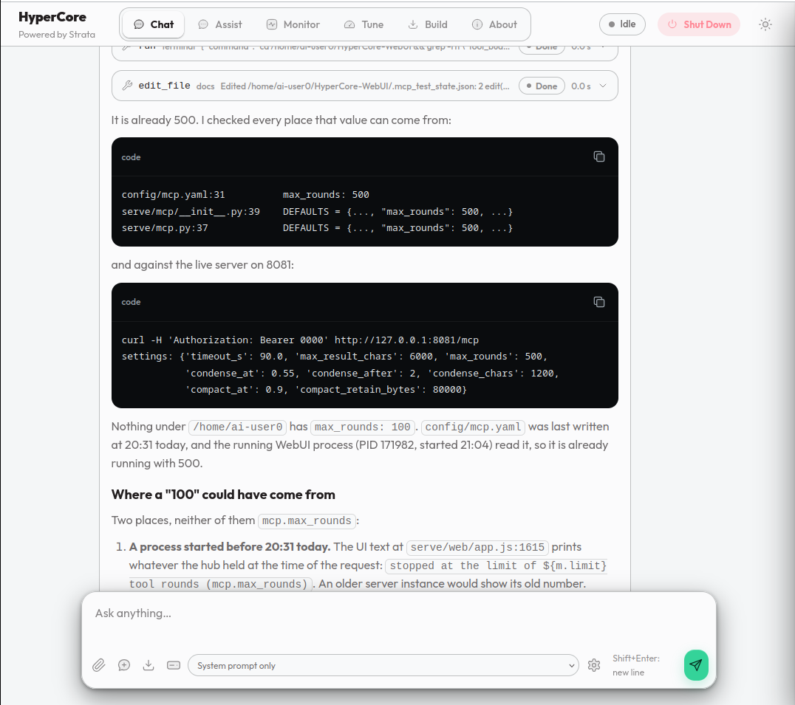
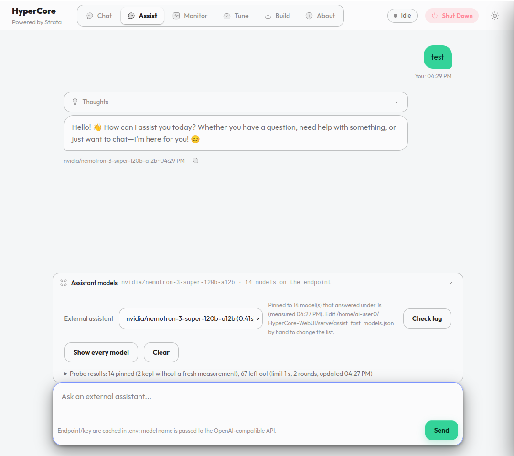
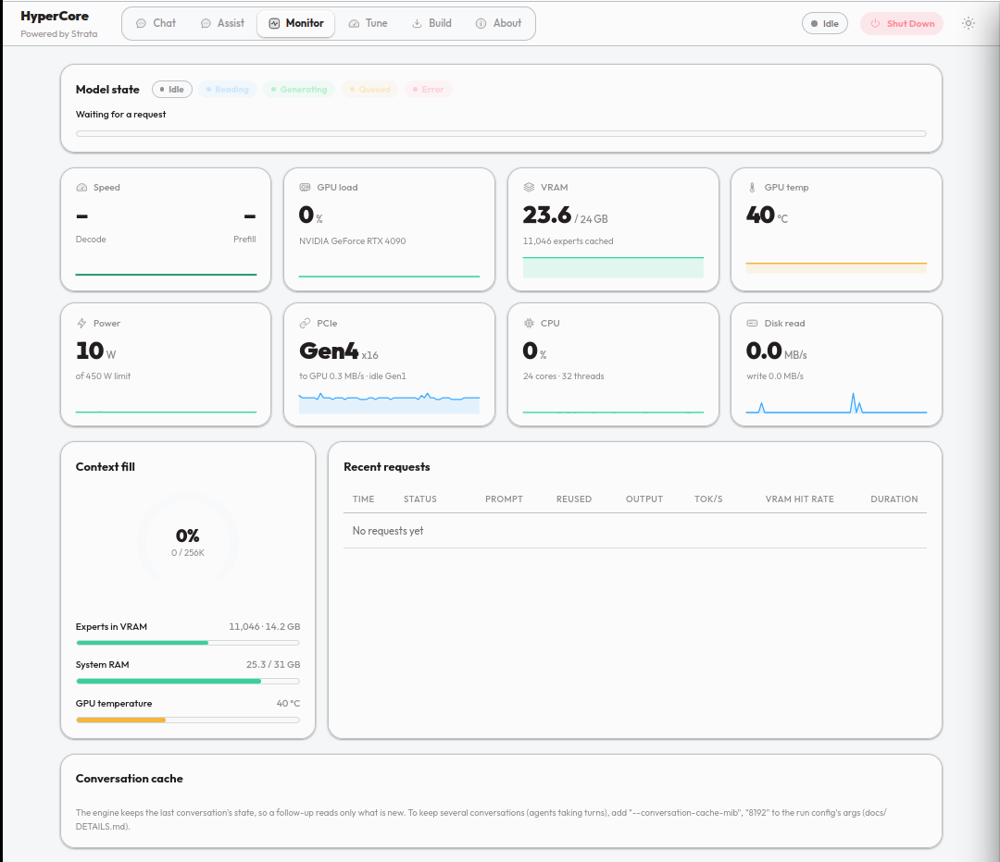
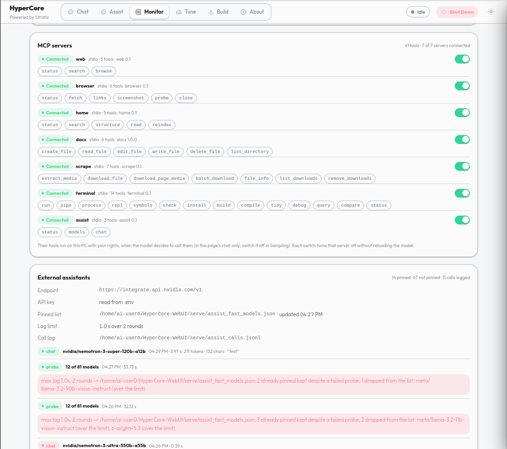
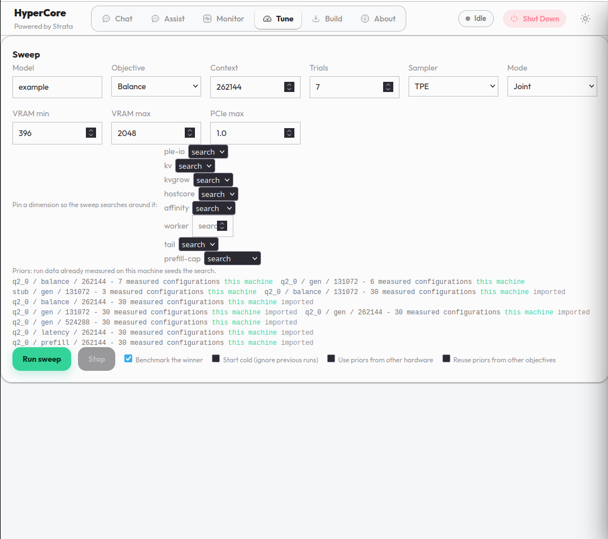
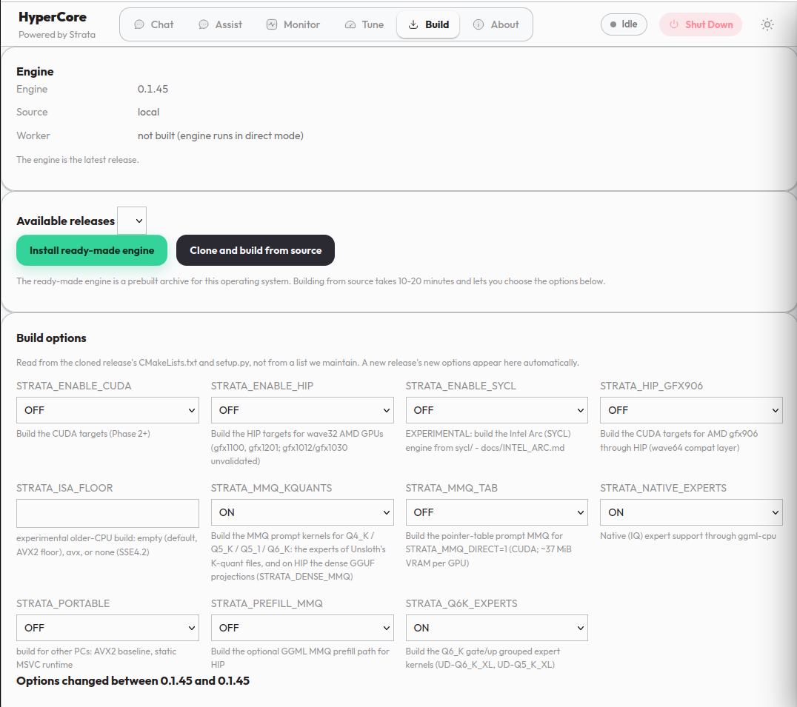
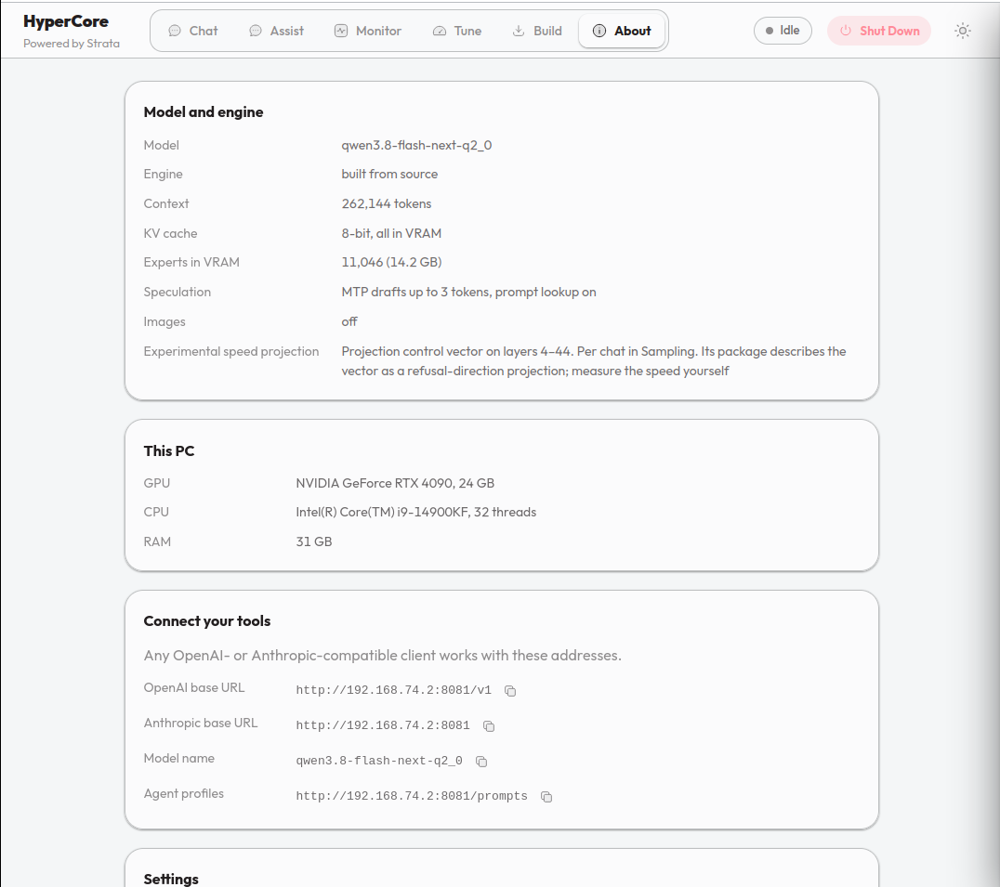

# HyperCore-WebUI

**HyperCore — Powered by Strata.**

The HyperCore web app (Chat, Assist, Monitor) running on a stock
[Strata](https://github.com/Niko1221/Strata) engine, plus two tabs the engine
does not ship: **Tune** (an Optuna sweep over the engine's settings) and
**Build** (check for a new Strata release, get it, and compile it).

This repository contains no engine source. The only native thing it needs at
runtime is `engine/strata`.

---

## The tabs

Six views, in the order they sit in the header: **Chat, Assist, Monitor, Tune, Build, About**.
Each is described first, then shown. The screenshots are the files in `data/media/`.

| Tab | In one line |
|---|---|
| **Chat** | The model, on this PC: streaming answers, thinking, agent profiles, attachments, MCP tools |
| **Assist** | A second chat through an external OpenAI-compatible endpoint, with a lag-probed model list |
| **Monitor** | Live engine and hardware metrics, the request table, the conversation cache, the MCP switches |
| **Tune** | An Optuna sweep over the engine's settings, run as a subprocess and reported here |
| **Build** | Check for a new Strata release, get it ready-made or build it from source |
| **About** | Engine provenance, this PC, the API addresses, the API key, the model settings |

### Chat

**What it does.** OpenAI and Anthropic chat over the engine that is resident on this machine.
Nothing leaves it unless you use Assist.

- **Streaming with thinking.** The answer arrives token by token; the reasoning block is
  shown expanded while it streams and collapsed afterwards, and it is kept in the saved
  transcript.
- **Attachments.** Text files attach through the paperclip, by dropping them on the chat or
  pasting them. Pictures go through the vision model when the run config has a `vision`
  entry.
- **Agent profiles.** The picker is built at run time from the top-level keys of
  `prompts/prompt.json`; anything that is not `system_prompt` is a profile.
- **Sampling and thinking.** The drawer sets thinking level, temperature, top-p, top-k,
  max tokens, the context cap, the seed, whether thinking is shown, whether MCP tools are
  offered, and the page surface. The surface is a browser setting and is never sent to the
  server.
- **Two ways out of a chat.** The download button writes the transcript to the browser's
  downloads folder; the archive button posts it to `POST /history/archive`, which writes it
  into `data/history/_old_chats/` for `tools/build_history.py` to distil.
- **Stop and Start.** One button, two states. While an answer is being written it is Stop;
  once a turn has ended it becomes Start, which types "Complete the open tasks" into the
  composer and sends it, so a chat that stopped mid-work picks up without you writing
  anything.
- **Context.** A request larger than the window is condensed before it reaches the engine,
  never silently cut.



### Assist

**What it does.** A second chat, through an external OpenAI-compatible endpoint rather than
the local engine. The endpoint and key are read from `.env`.

- **Model picker.** A folded panel that says in its summary which model is answering, so it
  can be closed without losing that.
- **Lag probing.** "Check lag" times every model the endpoint will serve and keeps the ones
  under the limit; "Show every model" lists the rest with the reason each was left out.
- **The call is logged.** Every Assist request is appended to `serve/assist_calls.jsonl`,
  which the Monitor shows.
- **Nothing is stored server-side.** Assist keeps no conversation cache; the turns are held
  in this browser.



### Monitor

**What it does.** The engine and the machine, live. `/metrics` is the source; the page is
rendered from it.

- **Model state.** Idle, Reading, Generating, Queued or Error, with a progress bar for the
  request in flight.
- **Metric cards.** Speed (tok/s), GPU load, VRAM, GPU temperature, power, PCIe, CPU and
  disk read, each with a sparkline of the last few minutes.
- **Context fill.** A gauge of how much of the window the current prompt uses, plus bars for
  experts resident in VRAM, system RAM and GPU temperature.
- **Recent requests.** Time, status, prompt size, prompt reused, output tokens, tok/s, VRAM
  hit rate and duration, with "Show all" for everything kept.
- **Conversation cache.** Parked conversations, their memory in RAM, and what was restored
  or evicted.
- **MCP servers.** Each server, its status and its tools. A switch turns that server off
  without reloading the model.
- **External assistants.** The Assist calls and the pinned model list.
- **Chat history.** How many transcripts are in `data/history/_old_chats/`, how many were
  distilled into `chats/`, `topics/` and `notes/`, which one was archived last, and when the
  last rebuild ran and how long it took. "Rebuild now" runs `tools/build_history.py` on the
  spot; the button is disabled while a rebuild is already running. Counts only, so polling it
  is cheap (`GET /history/status`).





### Tune

**What it does.** Runs `optuna_tune/bayesian_tune.py` as a subprocess and reports the sweep
here. The chat engine is unloaded first, because a sweep boots its own engine and needs the
GPU.

- **The sweep.** Model, objective (generation tok/s, prefill tok/s, latency, balance),
  context length, trial count, sampler (TPE, GP, random) and mode (joint or staged), with
  VRAM min/max and a PCIe ceiling.
- **Pins.** Any dimension can be pinned so the search goes around it instead of across it.
- **Priors.** Run data already measured on this machine seeds the search. The panel lists
  what a sweep would load and whether it matches this hardware; priors from other hardware
  or other objectives have to be ticked on before they are used.
- **Results.** A progress bar, the winner's configuration, a row per trial with its
  measurements, and an export of the run config pair.

**Do not close the page while a tune is running.** The subprocess writes the results to
disk and the tab reports them when it exits.



### Build

**What it does.** Gets the engine. It does not need an internet connection to know what is
installed, only to find a new release.

- **Installed version** read from `engine/BUILD.json` or from the string compiled into the
  binary.
- **Releases** pulled from the GitHub releases API for Niko1221/Strata: install the
  ready-made archive for this OS (its published SHA-256 is verified), or clone and build
  from source.
- **Build options** are extracted from the cloned release's own `CMakeLists.txt` and
  `setup.py`, not from a list this project maintains, and diffed against the previous
  manifest so a new release's new options appear here automatically.
- **Build log** streams while the compile runs. `tmp/` holds one clone and is deleted when
  the build finishes.



### About

**What it does.** Everything you would otherwise have to ask the server about.

- **Model and engine**: which model is loaded, which engine binary is running, and where it
  came from.
- **This PC**: GPU, driver, RAM, CPU, and the context the model is running with.
- **Connect your tools**: the OpenAI- and Anthropic-compatible addresses this server answers.
- **Settings**: the API key (only needed if the server was started with one), the dark theme
  toggle. Chats, settings and the key stay in this browser.
- **Model settings**: the documented keys of the run config, written for every client. An
  empty field is the default, and a change takes effect the next time the model starts.



## Running it

```bash
./setup.sh                 # create .venv, find or fetch an engine
./run.sh                   # start the WebUI on http://localhost:8081
```

Point the app at an engine and a model in `config/run-<model>.json`, or set them
in the Config view. `config/run-example.json` is the template; copy it and fill in
the paths. The defaults are host `0.0.0.0`, port `8081`, API key `0000`.

The engine is found in this order: `--engine`, the run config's `"engine_url"`,
`--engine-url` / `$HYPERCORE_ENGINE_URL`, the run config's `"exe"`,
`engine/strata`, then `STRATA_ENGINE`.

## One engine per machine

A Strata engine is tens of GB. Two WebUIs on one PC cannot both hold it, so the
second one attaches to the first instead of starting a second copy. This is
automatic: before starting an engine the server asks the port the run config names
(and the usual ones) for a `/health`, and attaches to whatever answers.

```bash
./run.sh                                          # attaches to an engine already loaded
./run.sh --no-attach                              # start this project's own engine anyway
HYPERCORE_ENGINE_URL=http://127.0.0.1:8080 ./run.sh   # name the engine to attach to
```

`run.sh` also checks the port before starting: if the WebUI is already up there, it
opens that page rather than loading the model twice.

Before an engine is spawned, the paths in the run config are checked. A model that
is not on disk takes minutes of loading to say so, and the engine says it in the
same breath as its memory guard, which reads as a RAM problem and is not one - so
`missing_paths` reports the offending flags first, and the exit message tells a
missing file as a missing file.

Attaching goes through the OpenAI API the running engine's server already speaks.
The prompt is decoded with the model's tokenizer, sent as one message, and every
text piece that comes back is encoded again, so Chat, the token counters and the
Monitor see the same token stream as from a local engine. The server that started
the engine still owns it: `stop`, `unload` and VRAM resize are asks, not commands,
and the About tab says which address the engine lives at.

## When the GPU is busy elsewhere

A tune sweep, a build, or another model server can hold the card, and the app should
not go down with it. The HTTP server and the engine are separate lifecycles: if the
engine cannot start, the server binds the port anyway, serves the page, and reports
the engine as offline.

```bash
./run.sh --ui-only                      # the app, with no engine at all
./run.sh --engine-retry-s 60          # how often an engine that failed is retried
HYPERCORE_HOLD_THE_CARD="the 200-trial sweep" ./run.sh   # tell the retry to wait
```

What still works with no engine: the page itself, the Monitor, the Tune and Build
tabs, the MCP switches, the Assist chat, the About tab, the chat archive and the
history rebuild. What does not: a chat request. It is answered `503 engine_unavailable`
with the reason and a `Retry-After`, and the Chat tab shows a banner saying so with a
Load button.

The engine is retried in a background thread every `engine_retry_s` seconds (default
30, `"engine_retry_s"` in the run config, `--engine-retry-s` on the command line, 0
to turn it off). Pressing Load tries once, immediately. When the card is free the
engine is adopted in place and the banner disappears; no restart of the WebUI is
needed.

While a sweep or a build of this project has the card, the retry makes no attempt and
`GET /health` reports `engine.retry.state: "paused"` with the reason in `paused_reason`.
That is deliberate: an attempt would fail, and the process it spawns disturbs the
numbers the sweep is measuring. The banner says so and the Load button reads "Try
anyway" for anyone who wants to force it.

A sweep started from the CLI (`optuna_tune/max_tune.sh`) is a separate process and the
web server cannot see it, so name it: `HYPERCORE_HOLD_THE_CARD="the 200-trial sweep"`.
The retry then holds off for as long as that sweep runs.

## How the Build tab works

1. Reads the installed version from `engine/BUILD.json`, or from the
   `engine=X.Y.Z` string compiled into the binary.
2. Queries the GitHub releases API for `Niko1221/Strata`.
3. Either downloads the ready-made archive for this OS and verifies its published
   SHA-256, or shallow-clones the release into `tmp/`, builds it, and copies the
   binaries into `engine/`.
4. The build dropdowns are extracted from the cloned release's own
   `CMakeLists.txt` and `setup.py` by `tools/extract_build_options.py`, and
   diffed against the previous manifest so the tab can show what changed.

`tmp/` holds exactly one clone, is deleted when a build finishes, and is never
read at runtime. Deleting it changes nothing.

## How the Tune tab works

The sweep is a subprocess of `optuna_tune/bayesian_tune.py`, so the CLI stays
the single source of truth and the web server stays responsive during a run that
can take an hour. The chat engine is stopped first, because a sweep boots its own
engine and needs the GPU.

**Do not close the page while a tune is running.** The results are written to
disk by the subprocess and reported here when it exits.

### Priors: reusing measurements you already have

A sweep does not start from nothing. `optuna_tune/history/` holds one file per
machine, model, objective and context length, and each sweep folds its own trials
into it, so the next one searches around what already worked on this box.

If you have a previous HyperCore install, its measured configurations can be brought
over:

```bash
python tools/import_tune_history.py                      # from ~/black_box/optuna_tune/history
python tools/import_tune_history.py --source /path/to/history --top 50
python tools/import_tune_history.py --all                # keep every configuration
```

The importer keeps the record format unchanged and drops the weight: DRY rows (a
`--dry-run` bookkeeping entry is not a measurement) are discarded, duplicate
configurations fold to their best score, and only the top N by score are written.
Imported files are named `seed-<slug>_<model>_<objective>_<context>.json` and carry
`"seed": true` plus the path they came from, so a prior can be traced.

Seven such priors ship with the repository: the best 30 configurations per
objective measured on an i9-14900KF / RTX 4090 / 31 GB / PCIe4x16 box, 228 KB in
total. They are real measurements of real runs, but of that machine. The tuner
loads a record only when the hardware fingerprint matches, so on any other box the
Tune tab lists them as "other hardware" and you have to tick **Use priors from
other hardware** before a sweep will use them. Nothing here makes a foreign
measurement silently authoritative.

`optuna_tune/results/` - the raw per-trial logs and CSVs - is not imported and is
not committed; the history file is the distilled form of it.


## Keeping the history

The Chat tab's archive button writes a transcript to `data/history/_old_chats/`. That is the
input, not the output. `tools/build_history.py` distils it in three steps:

```bash
python3 tools/build_history.py            # transcripts -> chats/ -> topics/ -> notes/
python3 tools/build_history.py --topics   # counts only, writes nothing
```

Archiving a chat runs that rebuild by itself, in a background thread, so the button does not
wait for it. Two archives in the same minute start one rebuild, not two. `GET /history/distil`
reports whether a rebuild is running and what the last one returned; `POST /history/distil`
runs one now and returns the result. `HYPERCORE_AUTO_DISTIL=0` turns the automatic pass off
and leaves the archive button as a plain save; `HYPERCORE_DISTIL_SCRIPT` points the hook at a
builder kept elsewhere.

- `chats/<date>-<name>.md` - one transcript: what was asked, what came of it.
- `topics/<topic>.md` - every fact, decision, measurement, warning and open item about a
  topic, grouped by the thing it is about, dated and attributed.
- `notes/<topic>.md` - the current state of a topic, hand-maintained and kept by the builder.

The extraction is deterministic and does not depend on which chat said something: a sentence
is kept only when it names something concrete (a file, a flag, an identifier, a number with a
unit) and states a fact about it. Keys and addresses are replaced with markers, paths written
against an older project name are rewritten to the ones that exist here, and restatements of
the same finding are merged with every source kept as provenance.

## The end-of-turn check

`--turn-tail-check` (or `"turn_tail_check": true` in a run config) makes the server ask the
model, at the end of a turn, whether every task in the request is done. A bare confirmation ends
the turn; a "no" or a mention of remaining work keeps it going, up to `turn_tail_checks` times
(default 3). It is off by default.

A run config is per model. To switch the behaviour off for a whole install, whatever every model
config and every command line says:

```bash
HYPERCORE_NO_TURN_TAIL_CHECK=1 ./run.sh
```

The server prints that the request was overridden, and `GET /v1/status` reports
`"turn_tail": {"enabled": false}`.

### Measuring whether it helps

`tools/turn_tail_measure.py` runs the same prompt against the server you already have running
(check off) and against a second server it starts in attach mode against that same model
(check on), then prints the number of tail checks that ran, the characters the answer grew by,
and how many of the parts the prompt named were covered:

```bash
python3 tools/turn_tail_measure.py --self                                   # mock pair, no GPU
python3 tools/turn_tail_measure.py --base http://127.0.0.1:8081 --key 0000
python3 tools/turn_tail_measure.py --prompts my_prompts.json --runs 3 --json
```

A prompt file is a JSON list of `{"name", "prompt", "must": [...]}`, where `must` is what a
complete answer has to contain. `--thinking-budget` matters: a turn that runs out of tokens
while still thinking ends with `finish_reason: length` and is never tail-checked, so a thinking
model needs a budget for the comparison to mean anything. `--self` proves the wiring against a
mock script; its numbers say nothing about a real model.

## Layout

```
serve/          the web app and its server
  web/          index.html, app.js, monitor.js, the styles and the icon sprite
optuna_tune/    the Bayesian tuner
  history/      run data keyed to this machine; seed-* priors are committed
  results/      raw sweep logs and CSVs (not committed)
tools/          build_engine.sh, extract_build_options.py, import_tune_history.py,
                run_tests.sh and build_history.py
engine/         the engine binaries (not committed)
engine-src/     the HyperCore process boundary injected into a Strata clone
config/         run configs and the build manifest
prompts/        the agent profiles
data/media/     the screenshots in this README
data/history/   the chat archive and the distilled topic files (local)
logs/ tmp/      local
```

Nothing loose sits in the repository root.

## License

MIT. The Strata engine is copyright Niko1221 and contributors, MIT licensed.
